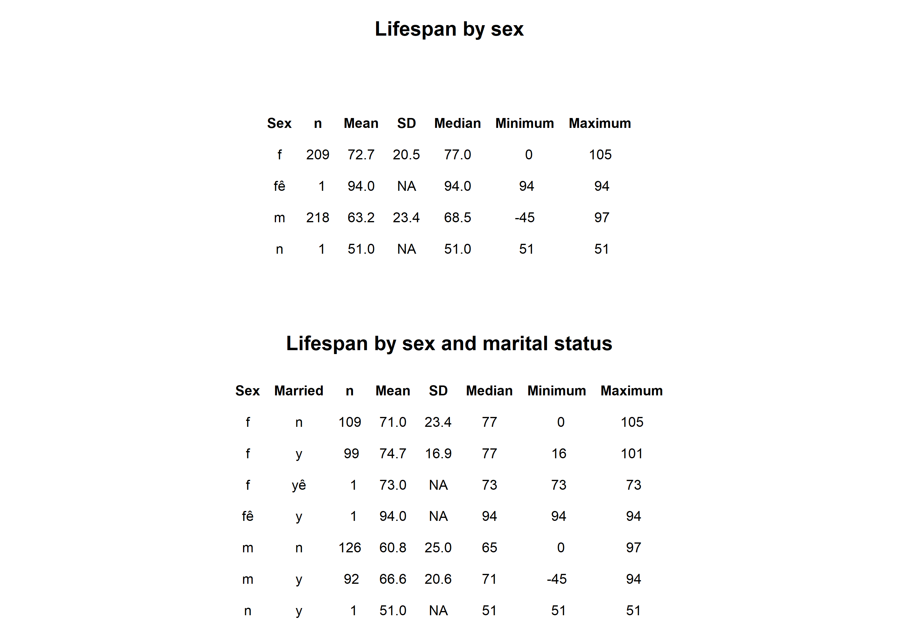
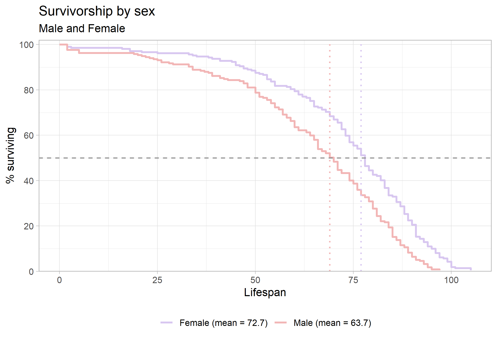

```{=latex}
\onecolumn
\begingroup
\thispagestyle{empty}
\sffamily

% Publication line and journal masthead
\noindent
\begin{minipage}[t]{0.66\linewidth}
  \scriptsize
  Linaje and Lango. \textit{Survivorship Curves of Sunset Hill Cemetery}
  \hfill (2026) 1:1\\
  Valdosta State University, Ecology and Evolution
\end{minipage}
\hfill
\begin{minipage}[t]{0.30\linewidth}
  \raggedleft
  \large Cemetery Demography\\[-2pt]
  \large BIOL 3250
\end{minipage}

\vspace{0.28in}

% Article-type band
\noindent
\colorbox{reportred}{%
  \parbox{\dimexpr\linewidth-2\fboxsep\relax}{%
    \color{white}
    \textbf{RESEARCH ARTICLE}\hfill
    \textbf{CLASS PROJECT}
  }%
}

\vspace{0.18in}

% Title and author line
\noindent
{\fontsize{23}{27}\selectfont
\textbf{Lifespan is Affected by Sex}\par}

\vspace{0.12in}

\noindent
{\small
Maria Linaje, Canijah Lango.\textsuperscript{1,*}
}

\vspace{0.08in}

% Structured abstract
\setlength{\fboxsep}{6pt}
\noindent
\fcolorbox{reportred}{white}{%
  \begin{minipage}{\dimexpr\linewidth-2\fboxsep-2\fboxrule\relax}
    \small

    \textbf{Abstract}

    \vspace{3pt}

    \textbf{Purpose:}
    This project describes lifespan patterns in cemetery records and examines
    variation by sex.

    \vspace{3pt}

    \textbf{Methods:}
    Recorded available birth and death information from gravestones
    and classified selected characteristics using evidence visible on the
    stones and in burial arrangements.

    \vspace{3pt}

    \textbf{Results:}
    The patterns for both married and unmarried women show that they have a greater mean lifespan than men in all categories.

    \vspace{3pt}

    \textbf{Conclusions:}
    Women live longer than men regardless of marital status, as supported by the data collected. However, this data set was collected from only 1 cemetary in southeast Georgia and may not accurately reflect the patterns of the whole species in all time periods.

    \vspace{3pt}

    \textbf{Keywords:}
    cemetery records; lifespan; survivorship; marital status; historical demography
  \end{minipage}%
}

% Bottom-page author and institutional details
\vfill

\noindent\rule{0.56\linewidth}{0.4pt}

\vspace{3pt}

\noindent
{\scriptsize
\textsuperscript{*}Correspondence: mlinaje@valdosta.edu; cclango@valdosta.edu\\
\textsuperscript{1}Department of Biology, Valdosta State University,
Valdosta, Georgia, USA\\
Ecology and Evolution, BIOL 3250, Section B
}

\vspace{0.10in}

\noindent
\begin{minipage}[c]{0.20\linewidth}
  \includegraphics[width=0.72in]{Valdosta_State_University_seal.png}
\end{minipage}
\endgroup
\twocolumn
```

# Background

Cemetery records provide individual birth and death dates that can be used to describe lifespan among people represented in a burial ground. These records are a non-random sample: cemetery access, preservation of markers, migration, family burial practices, and the choice of graves to record may all affect which people appear in the dataset. The analyses below therefore describe the collected sample and should not be treated as direct estimates of lifespan for an entire town or historical population.

# Hypotheses

1. **Sex and lifespan:** I hypothesize that women will have a greater lifespan than men in this sample because of labor, lifestyle risks, and societal standards.

# Methods

Lifespan data was collected from the information found on tombstones in 1 cemetary in Valdosta, GA. The name, sex, birthdate, and death date was recorded from at least 50 tombstones per group in the class, and that data was aggregated to create the complete data set used in this report.

## Field site and sampling

- **Where did you go?** Sunset Hill Cemetary in Valdosta, GA, data taken from first 2 rows that begin that middle section beyond the first road.
- **What date and time of day did you collect records?** 7 October 2026, 2:30 pm to 3:30 pm
- **What part of the cemetery did you sample?** C-201 and C-202.
- **How did you choose graves?** After being assigned a section, each row was collected parallel with the tombstones until at least 50 data points were collected.
- **How did you handle nearby graves and family plots?** Each tombstone was recorded in a family plot with the family name added at the end of each tombstone name.

## Recorded information and variable definitions

- **What information did you record from each marker?** Name, birth date, death date, sex/gender as recorded or inferred, marriage indicator, military indicator, and inscription details.
- **How was lifespan calculated?** Whole years were used in the data sets.
- **How did you determine marital status?** If there was any indication of mother, father, wife, husband, or son/daughter of (2 names of parents), or there was a typical male and female name beside each other on a family plot with a birth year gap of less than 15 years, or females with 2-3 surnames, they were assumed to be married.
- **How did you determine military service?** If there was an obvious inscription or medal stating they were a veteran, then military service was generally recorded as yes or no.
- **How did you determine sex or gender?** Most sexes were assumed based on what was most typical for male or female for the year they were born according to google.
- **How were missing, illegible, or ambiguous records handled?** 1 tombstone with initials only was excluded from data set.

## Dataset and analysis

- **How many records were collected by you?** n = 83
- **How many records were included in the final analysis?** n = 82; 1 with only initials was excluded.
- **Were records aggregated with the class dataset?** Yes. Each group was assigned a different section of the cemetary.
- **What summaries or plots were produced?** [Describe group summaries and empirical survivorship curves, including how categories were defined.]
- **What are the limits of the sample?** Some headstones only had years and not month and day, so all data was reduced to just years. The closest cemetary to the university was chosen for sampling, and groups were assigned sections at random.

# Results

The summary table in @fig-summary shows substantial differences in recorded lifespan by sex in this sample. Males had a mean lifespan of 59.0 years (SD = 20.4; n = 3), compared with 29.7 years (SD = 7.1; n = 3) for females. The marital-status breakdown is more tentative because each subgroup contains only one or two records. Among males, the two married individuals had a mean lifespan of 70.5 years (SD = 6.4), while the one unmarried individual lived 36 years. Among females, the one married individual lived 36 years, compared with a mean of 26.5 years (SD = 6.4) for the two unmarried individuals. These small subgroup sizes make the values descriptive; they do not support broad conclusions about sex or marital status. 

{#fig-summary width=90% fig-pos="t" fig-env="figure*"}

The sex-specific survivorship curves in @fig-sex show a different pattern: the plotted means are 61.1 years for males and 57.3 years for females. The male curve remains higher through much of the earlier and middle lifespan, while the female curve reaches the 50% survival point later. The curves are close and change relative position, so the figure suggests that the sex difference depends on which part of the lifespan distribution is considered. The median markers indicate where each group’s observed curve reaches 50% surviving; they are distinct from the mean values shown in the legend.

{#fig-sex width=70% fig-pos="t" fig-env="figure*"}

# Discussion

**Sex and lifespan.** Research on sex differences in longevity points to a combination of biological, behavioral, and social influences rather than a single explanation. Austad and Fischer review evidence on sex differences in lifespan and aging across species, including humans [@]. In this cemetery sample, the observed female and male curves [describe the pattern] and support the prediction that females tend to live longer than males, regardless of marital status. The result should be interpreted in the context of this cemetery’s birth cohorts and sampling process; it is not by itself an estimate of a general sex difference in lifespan.

**Marital status and social relationships.** Marriage can correlate with social support, health behaviors, household resources, and social integration, but people’s health can also influence whether they marry or remain married. A large meta-analysis found associations between unmarried status and mortality, with some associations differing by sex [@wangSexDifferencesAssociation2020]; a broader meta-analysis linked social relationships with mortality risk [@holt-lunstadSocialRelationshipsMortality2010]. In this dataset, the comparison of married and not-married records among men and women showed that most women have a longer lifespan than men. These cemetery records do not measure relationship quality, social contact, or the timing and duration of marriage, so marital status should be treated as an imperfect indicator rather than a direct measure of socialization or a cause of longevity.

**Historical changes in lifespan and childhood survival.** Life expectancy at birth is strongly affected by deaths in infancy and childhood, so a low historical average does not mean that every adult died young. Improvements in clean water and sanitation contributed substantially to mortality declines in the United States during the twentieth century, especially for infants and children [@cutlerRolePublicHealth2005]. The birth-period pattern in this sample [describe results] may be consistent with changing survival conditions, but birth year alone cannot identify which changes mattered. Vaccination, nutrition, medical care, living conditions, and the incomplete representation of people in cemetery records may also contribute to differences across cohorts.

**Limitations and next steps:** This data is only reflective of the 429 samples aggregated from 1 class from 1 cemetary. Some errors could occur from incorrect inference of sex, marital status, and family cluster assumptions. Data can possibly be skewed from mid-1900's on because of current surviving family members, making the data incomplete until every member of the family/group has passed away.

```{=latex}
\newpage
```

### References

::: {#refs} 
::: 
